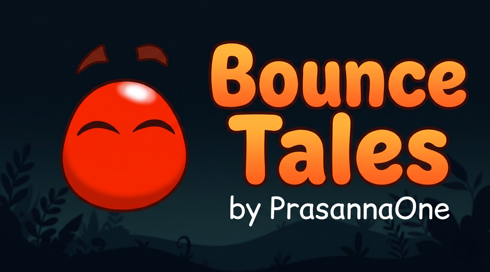

<div align="center">

# 🟠 BOUNCE TALES
### The classic bounce, carefully rebuilt for the browser.

<p><a href="https://prasannaone.github.io/BounceTales/"></a></p>

## 🌐 [prasannaone.github.io/BounceTales](https://prasannaone.github.io/BounceTales/)

<p>
  
  
  
  
  
  
</p>



*An independent, source-informed browser reimplementation inspired by the classic J2ME game.*

</div>

---

## ✨ Welcome back to Bounce's little world

Bounce Tales brings the familiar red bouncing hero and its platforming world to modern browsers. The project rebuilds the experience around a **240 × 320 logical game world**, recovered resource formats, original game artwork, a modular JavaScript runtime and responsive browser controls.

The aim is preservation with thoughtful modernization: keep the game's personality, make it comfortable to play on today's screens, and keep the source understandable enough to maintain and extend.

> 📱 **Jump straight in:** the official site is playable in a browser. No app-store installation or account is required.

## 🎮 How to play

| Action | Touch | Keyboard |
|---|---|---|
| Move left / right | Hold **◀** / **▶** | `A` / `D` or `←` / `→` |
| Jump / bounce | Hold **JUMP** | `Space` / `Enter` |
| Change unlocked form | Tap **`*`** | `Shift` / `Q` |
| Pause | Tap the pause button | `Escape` |

Standard gamepads are supported when the browser exposes the Gamepad API. Touch controls can be moved and resized in **Settings → Customize touch controls**. Your layout is saved locally in that browser on that device.

## 🌟 What is inside?

- 🕹️ **Original-scale simulation:** a logical 240 × 320 playfield, scaled to modern screens.
- 🧩 **Resource-aware runtime:** reads the 15 playable campaign RLEF resources while preserving all 16 original RLEF files and source-informed sprite/animation mappings.
- 🧭 **Campaign systems:** chapter progression, checkpoints, collectibles, scripted events and level objects.
- 🪀 **Platforming systems:** fixed-step updates, collision handling, bounce physics, forms, enemies, water and springboards.
- 🎨 **Original visual language:** in-game sprites and artwork are kept separate from modern PWA branding.
- 📳 **Phone-friendly controls:** touch, keyboard and supported gamepad input.
- 🛠️ **Live control editor:** reposition and resize the actual on-screen controls.
- 📦 **Installable PWA:** add the browser game to a compatible device's home screen.
- 🔊 **Soundtrack:** browser-based music and sound playback.

## 🧭 V58 · campaign parity scorecard

This release pins the original campaign script corpus and makes the current parity evidence easier to audit:

- 🧩 All 15 playable RLEF stages are enumerated: 316 events and 1,143 authored commands.
- 🧭 A new regression test pins the exact campaign opcode distribution and verifies both opcode-26 target references resolve to the player object.
- 🧪 The full gate runs 69 test files, syntax checks, all-stage runtime smoke, and the Level 1 springboard lifecycle proof. A new synthetic test exercises all 33 event interpreter opcodes against source-derived expectations.
- 📚 The scorecard separates verified campaign coverage from unproven semantic parity. It does not manufacture a 90% score from feature counts.

The Share button now sends or copies `https://prasannaone.github.io/BounceTales/`, matching the canonical page link and social metadata. The older X.gd target documented under V55 is historical and has been superseded.

See the [V58 campaign parity scorecard](docs/V58_CAMPAIGN_PARITY_SCORECARD.md), [V58 source crosswalk audit](docs/V58_SOURCE_CROSSWALK_AUDIT.md), [V58 release audit](docs/V58_RELEASE_AUDIT.md), and [engine porting guide](docs/ENGINE_PORTING_GUIDE.md).

## 🛡️ V50 · reproducible checks and safer runtime imports

V50 is a repository-readiness release. It preserves the gameplay simulation, original resource data and saved touch-layout geometry while strengthening the path from source changes to a published site. Its shell-level polish also moved the pause action outside the canvas and delayed touch-control visibility until measured geometry was applied; V51 refines both details.

- **Runtime ZIP imports are constrained:** `Bounce.zip` is validated before extraction, including path traversal, symlink/special-file, duplicate-path, encrypted-entry, file-count, file-size and expansion checks.
- **Protected project records stay protected:** the importer copies only the browser runtime allowlist (`index.html`, the site shell files, `assets/` and `src/`). It does not replace documentation, the license, tests, research notes, repository metadata or GitHub workflows.
- **Deployment is gated:** the imported runtime must pass syntax checks, the full Node.js regression suite, runtime smoke checks and the springboard lifecycle proof before it is committed.
- **Pull requests get the same quality gate:** GitHub Actions runs the complete dependency-free verification sequence on pushes and pull requests.
- **The import path is independently testable:** the ZIP validator is a checked-in Python tool, not an opaque shell-only extraction step.

The release is intentionally conservative: it improves how the project is checked and deployed without presenting infrastructure work as new gameplay. The V50 shell adjustments did not change the saved touch-layout format or gameplay simulation. See the [V50 release-readiness and deployment audit](docs/V50_RELEASE_READINESS.md).


## 🟠 V57 · original event-flag and sprite-effect fidelity

V57 corrects a source-level mismatch in the RLEF event interpreter and restores a small but authentic effect that campaign scripts rely on.

- **Packed flag semantics:** original opcode 29 selector `0x01` replaces all five low render-depth bits, not just bit zero. Selectors `0x20`, `0x80` and `0x100` remain independently applied. The render-depth cache now follows the original `(flags & 31) - 16` rule.
- **Campaign evidence:** the 15 playable RLEF stages contain 140 opcode-29 commands, including 25 combined depth/visibility updates. Tests verify the selector distribution and target data against the bundled original levels.
- **Original sprite-fragment effect:** the original image-358 sprite path emits 24 animated fragments using sprite families 390, 414 and 396, with the source lifetime/angular configuration. Browser-side timing, random sampling and particle integration are a documented adaptation, not a claim of deterministic J2ME RNG parity.
- **No unrelated redesign:** the chapter flow, controls, level data, physics constants, cannon behavior, audio mapping and sharing UI are carried forward.
- **Verification:** the focused event-flag and fragment tests join the complete syntax, regression, all-15-stage smoke and springboard checks.

See the [V57 event-flag and sprite-effect audit](docs/V57_EVENT_FLAG_PARITY.md).

## 🟠 V56 · supplemental original-resource fidelity

V56 investigates the previously under-documented `be` and `bv` resources using the supplied JAR resource index and decompiled resource-loader paths.

- **`be`:** three original type-5 records, each 86 bytes, at resource indices 90–92. Their offsets and individual SHA-256 hashes are recorded. The original world manager queues resource IDs 36 and 37 for loading in one state transition.
- **`bv`:** one 26-byte type-8 payload at resource index 109. Its thirteen big-endian words are decoded and preserved; values 28–35 correspond to the eight original MIDI resource IDs already mapped by the browser audio controller.
- **Type-system correction:** resource-index type 8 is distinct from RLEF scene-object type 8. The latter creates a `c(true)` scene object; the former is read as raw resource bytes.
- **No speculative behavior:** the exact consumer of `be` and the full meaning of `bv`'s header/trailer are not established by the examined source call paths, so V56 adds source-backed inventory and regression protection rather than an invented runtime feature.
- **Verification:** the new supplemental-resource test checks all `be` record boundaries/hashes, the complete `bv` word sequence, the MIDI-ID correspondence and all 214 dynamic sprite-map entries.

See the [V56 supplemental resource audit](docs/V56_SUPPLEMENTAL_RESOURCE_AUDIT.md).

## 🟠 V55 · clearer sharing and deployment hygiene

V55 is a focused shell and maintenance release. The game simulation, campaign resources, cannon behavior, soundtrack mapping, menus and touch layout are carried forward unchanged.

- **Share control:** the header share mark now uses a visible, outlined connected-node icon with a consistent stroke instead of dark, effectively invisible SVG shapes. Its accessible label and compact button footprint remain unchanged.
- **Share destination:** the native share sheet and copy fallback now use `https://X.gd/BounceTales`. The regular site navigation and canonical GitHub Pages address remain unchanged.
- **Runtime importer:** the ZIP validator accepts any internally consistent release number, checks every service-worker app-shell file, and does not require a test suite inside `Bounce.zip`. The repository keeps ownership of `tests/`; those tests run after runtime import and are not replaced by an uploaded archive.
- **Repository hygiene:** the importer no longer carries a V54 minimum, a hard-coded module floor or a test-suite replacement path. ZIP path, symlink, duplicate-entry, size and expansion safeguards remain.
- **Verification:** the V55 share UI/URL regression test joins the existing suite. The full syntax, regression, 15-stage smoke and springboard checks are recorded in the V55 audit.

The X.gd URL is the requested share target; its live redirect destination should be confirmed from a browser after the short-link owner settings are checked. This release does not claim that redirect verification succeeded.

See the [V55 share and maintenance audit](docs/V55_RELEASE_AUDIT.md).

## 🟠 V54 · original cannon mesh and audio reference parity

V54 restores the shared cannon artwork that the original game loads from its sixteenth RLEF resource, `bu`. This is not a sixteenth campaign stage: the original world manager loads it alongside each playable chapter as the cannon's reusable polygon mesh.

- **Original cannon geometry:** all 12 polygon records are parsed from `assets/original/bu`; the renderer draws the original black, grey and yellow mesh rather than a static placeholder sprite.
- **Original firing animation:** the three authored polygon poses interpolate over 500 ms, 100 ms and 300 ms. The player launch boundary remains at 600 ms, while the cannon animation finishes at 900 ms.
- **Audio resource map:** the eight original MIDI resources (`aw.mid` through `bd.mid`) are explicitly cross-referenced to the eight browser Opus tracks. Title, chapter-group, death and victory triggers are checked against the decompiled source call sites.
- **Audio regression checks:** tests parse MIDI timing and Ogg Opus duration metadata. Each browser track retains the observed approximately 1.1-second tail after its source MIDI duration. This confirms the mapping and timing envelope, not bit-identical waveforms.
- **Release integrity:** the V54 runtime cache identity was versioned consistently. The V55 universal importer now validates structure and cache consistency without a hard-coded release minimum; the cannon module remains part of the service-worker shell.
- **Verification:** all original campaign levels remain in the 15-stage chapter list; `bu` is loaded as shared cannon geometry, never exposed as a playable chapter.
- **Release checks:** 90 JavaScript files pass syntax checks, all 63 test files pass, all 15 campaign levels pass the runtime smoke check, and the Level 1 springboard proof passes.

See the [V54 parity and restoration audit](docs/V54_PARITY_AUDIT.md).

## 🟠 V53 · original menu-flow restoration

V53 restores the source-shaped title and pause command sets while retaining the separate browser settings entry point and the existing chapter-book scene. The title scene now presents Continue (when a valid persisted save exists), New Game, High Scores and Instructions; the original Exit softkey is represented with a browser-safe close-tab attempt and a clear fallback message. The pause scene is reduced to Resume, Restart Chapter and Chapter Selection, with the existing confirmation path retained for destructive transitions.

- **Version identity:** package metadata, HTML asset query strings and the service-worker cache use V53 consistently.
- **Historical import rule:** V53 originally introduced a minimum import version. V55 removes that obsolete floor while retaining structural and cache-integrity validation.
- **Regression coverage:** menu-flow assertions now check the original command order and ensure web-only Options/Chapter Selection entries do not leak into the title menu.
- **Verification:** `npm run verify` passes all 61 test files, the Node runtime smoke test exercises all 15 RLEF stages, and the Level 1 springboard lifecycle proof passes.

See the [V53 restoration audit](docs/V53_RESTORATION_AUDIT.md). Browser-specific visual checks and physical handset testing remain separate from Node verification.

## 🟠 V52 · responsive-shell cleanup and reliable audio departure

V52 keeps the original game simulation, campaign resources, menus and saved touch-layout format intact while removing the accumulated shell cascade and tightening lifecycle behavior.

- **One responsive layout system:** historical overlapping layout patches are consolidated into one shell contract for portrait, landscape, compact phones and wide screens. The pause control remains outside the 240 × 320 game viewport in a reserved gutter or the clear strip above the game column.
- **No control-layout flash:** saved/default control geometry is applied before resource-loading awaits. The controls remain unpainted until measured, and are hidden again while a resize/orientation update is being applied.
- **Audio stops on departure:** leaving or backgrounding the page invalidates pending audio loads, stops the active source and suspends the AudioContext. Returning can restore the prior music only after the browser has previously unlocked audio and music remains enabled.
- **Version consistency:** package metadata is `52.0.0`; HTML and service-worker assets retain the V52 URL identity. The changed V52 worker refreshes the V52 cache entries on installation.
- **Preservation boundary:** the 15 playable RLEF stages, original resource archive, gameplay physics, progression and saved layout key are not intentionally changed by this shell-maintenance release.

The verification suite checks the real JavaScript modules and parsed RLEF resources in Node.js. It does not replace physical-device testing across Safari, Firefox, Android WebView or different browser versions. See the [V52 release audit](docs/V52_RELEASE_AUDIT.md).

## 🎯 V51 · clean first paint and a quieter pause control

V51 is a responsive-shell and startup-order maintenance release. It keeps the V50 gameplay/runtime systems and original campaign resources intact.

- **No legacy control flash:** the saved or default touch layout is measured and applied synchronously before game resources are fetched. The control surface remains hidden until all button geometry is ready.
- **External pause control:** a small 32 × 29 CSS-pixel pause button sits in the empty right-side gutter near the upper edge of the game. It is outside the canvas and appears only during active play. Wide two-column layouts place it in the clear strip above the game column.
- **Responsive stage sizing:** the pause strip and canvas share one sizing wrapper across portrait, landscape, compact and wide layouts.
- **Cascade audit:** exact duplicate CSS rule blocks were removed. Context-specific historical overrides were retained where they still define responsive behavior, rather than flattening the cascade and risking regressions.
- **Cache refresh:** the V51.1 correction uses `v=52` asset references and a distinct `bounce-tales-v52` service-worker cache so the corrected layout is not trapped behind the earlier V51 cache.
- **Regression coverage:** first-paint ordering, pause placement, hidden-state behavior and responsive stage rules are checked alongside the existing gameplay tests.

See the [V51 responsive-shell audit](docs/V51_RESPONSIVE_SHELL_AUDIT.md).

## 🚀 Play and install

1. Visit **[the official Bounce Tales site](https://prasannaone.github.io/BounceTales/)**.
2. Start a chapter and use the on-screen controls, keyboard or a supported gamepad.
3. On a compatible browser, choose **Install app** or **Add to Home Screen** to install the PWA.

The service worker requires HTTPS or `localhost`. The official GitHub Pages site is served over HTTPS.

## 🧑‍💻 Run locally

The site is static-hosted. You do not need a bundler, third-party package install or build step for normal play. Node.js 18 or later is needed for the repository validation scripts. Opening `index.html` directly through `file://` is not supported.

```bash
python -m http.server 8000
```

Then open <http://localhost:8000/>.

## 🧪 Development and verification

The repository has no runtime or development dependencies. The included npm scripts simply wrap the existing Node.js checks:

```bash
npm test                  # All regression and runtime test files
npm run check             # Syntax-check JavaScript source, tests and tools
npm run smoke             # Browser-runtime smoke harness
npm run proof:springboard # Level 1 springboard lifecycle proof
npm run verify            # Complete verification sequence
```

The test suite covers resource parsing, fixed-point arithmetic, physics/collision, level scripting, input, touch layout, audio, menus, timing, PWA references, visual regressions and the reusable port-engine registry.

Passing automated checks does not prove exhaustive parity on every physical device. Touch ergonomics, viewport scaling, browser audio policy, PWA installation and final visual composition still deserve real-device testing.

## 🏗️ Project map

```text
BounceTales/
├── index.html                 Browser shell, metadata, canvas and accessible UI
├── style.css                  Responsive layout and presentation
├── game.js                    Bounce Tales state, loop and rendering coordinator
├── sw.js                      Offline startup shell and runtime caching
├── manifest.webmanifest       PWA installation metadata
├── package.json               Dependency-free validation scripts
├── src/
│   ├── module-registry.js     Standalone generic module-registry utility (API v1)
│   ├── port-engine.js         Bounce Tales system catalog over the generic registry
│   ├── fixed-point.js         Fixed-point arithmetic
│   ├── game-timing.js         Fixed-step timing
│   ├── rlef-reader.js         Original RLEF resource parser
│   ├── terrain-collision.js   Geometry collision primitives
│   ├── bounce-physics.js      Bounce Tales player motion
│   ├── event-engine.js        Original scripted-event processing
│   ├── original-*.js          Bounce Tales compatibility systems
│   └── sprite-atlas.js        Validated sprite and animation lookup
├── assets/                    Original runtime art, audio and resources
├── reference/                 Decoded fixtures and resource metadata
├── reverse-engineering/       Research notes and bytecode traces
├── docs/                      Audits, guides and porting documentation
├── tests/                     Node.js regression and validation suite
├── tools/                     Test runner, syntax checker and resource tools
├── ARCHITECTURE.md             Runtime architecture and non-regression boundaries
├── LICENSE                    Sovereign Source License v1.1
└── README.md                   Project overview and quick start
```

## 🧠 How the runtime is organized

`index.html` loads the browser shell and standalone modules. `game.js` remains the Bounce Tales application coordinator: it owns the chapter lifecycle, game-specific objects, update/render sequencing and integration. The `src/` modules separate timing, arithmetic, collision, events, resources, input, audio and game-specific systems so they can be inspected and tested independently. The dependency-free `src/module-registry.js` is the reusable registry utility; `src/port-engine.js` is Bounce Tales’ catalog over the existing modules.

The new `BouncePortEngine` registry provides a stable discovery API for those modules and a `createRegistry()` factory for independent future-port systems. It does **not** pretend the whole game is a universal engine. The [porting guide](docs/ENGINE_PORTING_GUIDE.md) explains which parts are useful foundations, which are specific to Bounce Tales, and how a future game's renderer/input/storage adapters should be separated.

The port combines recovered source/resource facts with browser-specific implementation choices. It is **source-informed**, not a claim that every original handset behavior has a perfect one-to-one browser equivalent. For the detailed update pipeline and invariants, read [ARCHITECTURE.md](ARCHITECTURE.md).

## 📚 Documentation shelf

| Document | What it covers |
|---|---|
| [Project guide](docs/PROJECT_GUIDE.md) | Runtime, controls, maintenance and release checklist |
| [Architecture](ARCHITECTURE.md) | Modules, simulation pipeline, resources and protected boundaries |
| [Engine porting guide](docs/ENGINE_PORTING_GUIDE.md) | Reuse boundaries and the new port-engine registry API |
| [V52 release audit](docs/V52_RELEASE_AUDIT.md) | Consolidated shell, startup controls, audio lifecycle, cache identity and test evidence |
| [V51 responsive-shell audit](docs/V51_RESPONSIVE_SHELL_AUDIT.md) | Startup layout, pause placement, CSS cascade audit and device-layout checks |
| [V50 release-readiness audit](docs/V50_RELEASE_READINESS.md) | ZIP import security, CI gates, scope and verification |
| [V57 event-flag and sprite-effect audit](docs/V57_EVENT_FLAG_PARITY.md) | Source-backed opcode-29 semantics, campaign coverage and original image-358 particles |
| [V57 release audit](docs/V57_RELEASE_AUDIT.md) | V57 scope, verification results and explicit fidelity limits |
| [V56 supplemental resource audit](docs/V56_SUPPLEMENTAL_RESOURCE_AUDIT.md) | Exact `be`/`bv` resource inventory, type-system distinction and regression coverage |
| [V55 share and maintenance audit](docs/V55_RELEASE_AUDIT.md) | Share UI/URL change, importer correction and V55 verification |
| [V58 campaign parity scorecard](docs/V58_CAMPAIGN_PARITY_SCORECARD.md) | Original campaign corpus, opcode distribution and parity limits |
| [V58 source crosswalk audit](docs/V58_SOURCE_CROSSWALK_AUDIT.md) | Original class-to-browser subsystem map and behavioral verification limits |
| [V58 release audit](docs/V58_RELEASE_AUDIT.md) | Release evidence, verification results, importer safety and open parity work |
| [V49 repository polish audit](docs/V49_REPOSITORY_POLISH_AUDIT.md) | Historical cleanup scope and verification boundaries |
| [V48 mobile readability audit](docs/V48_MOBILE_READABILITY_AUDIT.md) | Dialogue legibility and previous mobile HUD work |
| [V47 visual-parity audit](docs/V47_FULL_VISUAL_PARITY_AUDIT.md) | Original-game title/menu/HUD restoration |
| [Reverse-engineering method](docs/REVERSE_ENGINEERING_METHOD.md) | How reference resources are inspected and recorded |
| [Reference inventory](reference/README.md) | Decoded fixtures and resource provenance |
| [Reverse-engineering notes](reverse-engineering/BUILD_NOTES.md) | Historical research record and open questions |
| [License and attribution](LICENSE) | Proprietary source terms and third-party/original-game exclusions |

Older build-specific notes are intentionally retained as a research timeline. Their limitations describe the named historical pass, not necessarily the current release.

## ⚖️ License and original-game rights

The portions authored by Prasanna are covered by the **[Sovereign Source License v1.1](LICENSE)**. It is a **proprietary, source-available license**, not an OSI-approved open-source license. It permits limited personal, educational and noncommercial use under its terms; it does not grant general permission to republish, host, redistribute or monetise copies.

Original Bounce Tales artwork, sprites, animation, audio, music, fonts, level data, binary resources, names and marks are **not relicensed** by this project license. They remain subject to the rights of their respective owners. This is an independent project and is not affiliated with, sponsored by, or endorsed by Nokia or Rovio.

## 🔗 Project links

- 🌐 **Play:** [prasannaone.github.io/BounceTales](https://prasannaone.github.io/BounceTales/)
- 💻 **Source:** [github.com/PrasannaOne/BounceTales](https://github.com/PrasannaOne/BounceTales)
- 👤 **Creator:** [Prasanna One](https://github.com/PrasannaOne)
- ☕ **Support:** [Ko-fi](https://ko-fi.com/prasannaone)

---

<div align="center">

**Made with care by Prasanna.** ❤️  
*Keep bouncing.*

</div>


### V51.1 · pause-gutter correction

The first V51 pause placement was incomplete: the toolbar had been moved in the HTML, but its CSS positioning was not explicitly reset. V51.1 anchors the toolbar to the game stage's upper-right external gutter, explicitly resets the button itself to static positioning, reserves right-side clearance on compact portrait screens, and refreshes the service-worker cache identity. The gameplay canvas, touch-layout storage key and game simulation are unchanged.
