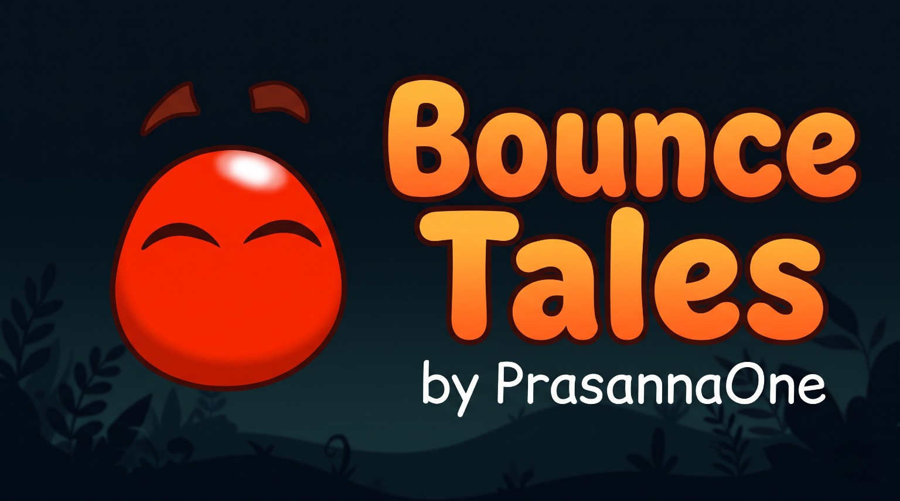

<div align="center">

# 🟠 BOUNCE TALES
### The classic bounce, carefully rebuilt for the browser.

<p><a href="https://prasannaone.github.io/BounceTales/"></a></p>

## 🌐 [prasannaone.github.io/BounceTales](https://prasannaone.github.io/BounceTales/)

<p>
  
  
  
  
  
  
</p>



*An independent, source-informed browser reimplementation inspired by the classic J2ME game.*

</div>

---

## ✨ Welcome back to Bounce's little world

Bounce Tales brings the familiar red bouncing hero and its platforming world to modern browsers. The project rebuilds the experience around a **240 × 320 logical game world**, recovered resource formats, original game artwork, a modular JavaScript runtime and responsive browser controls.

The aim is preservation with thoughtful modernization: keep the game's personality, make it comfortable to play on today's screens, and keep the source understandable enough to maintain and extend.

> 📱 **Jump straight in:** the official site is playable in a browser. No app-store installation or account is required.

## 🎮 How to play

| Action | Touch | Keyboard |
|---|---|---|
| Move left / right | Hold **◀** / **▶** | `A` / `D` or `←` / `→` |
| Jump / bounce | Hold **JUMP** | `Space` / `Enter` |
| Change unlocked form | Tap **`*`** | `Shift` / `Q` |
| Pause | Tap the pause button | `Escape` |

Standard gamepads are supported when the browser exposes the Gamepad API. Touch controls can be moved and resized in **Settings → Customize touch controls**. Your layout is saved locally in that browser on that device.

## 🌟 What is inside?

- 🕹️ **Original-scale simulation:** a logical 240 × 320 playfield, scaled to modern screens.
- 🧩 **Resource-aware runtime:** reads the 15 playable campaign RLEF resources while preserving all 16 original RLEF files and source-informed sprite/animation mappings.
- 🧭 **Campaign systems:** chapter progression, checkpoints, collectibles, scripted events and level objects.
- 🪀 **Platforming systems:** fixed-step updates, collision handling, bounce physics, forms, enemies, water and springboards.
- 🎨 **Original visual language:** in-game sprites and artwork are kept separate from modern PWA branding.
- 📳 **Phone-friendly controls:** touch, keyboard and supported gamepad input.
- 🛠️ **Live control editor:** reposition and resize the actual on-screen controls.
- 📦 **Installable PWA:** add the browser game to a compatible device's home screen.
- 🔊 **Soundtrack:** browser-based music and sound playback.

## 🧭 V49 · the polish and portability pass

This release focuses on the whole project rather than changing how Bounce moves:

- 🟢 The pause control is moved below the original clock footprint and keeps a compact, comfortable touch target.
- 💬 Cannon aiming/firing guidance now updates an accessible live region without adding another visible row or shrinking the mobile game area.
- 🧰 The existing standalone modules are exposed through **Bounce Port Engine API v1**. The generic registry is also a standalone utility for independent future ports, with a clear boundary between reusable helpers and Bounce-specific behavior.
- 🧹 Duplicate unused PWA icon copies and dead DOM references are removed; exact CSS duplicates are cleaned without flattening responsive cascade rules.
- 📚 README, architecture, project guide and historical reverse-engineering notes are reconciled for the current release.
- 🧪 A dependency-free Node.js workflow makes syntax checks, regression tests and smoke proofs repeatable.

See the [V49 repository polish audit](docs/V49_REPOSITORY_POLISH_AUDIT.md) and [engine porting guide](docs/ENGINE_PORTING_GUIDE.md).

## 🚀 Play and install

1. Visit **[the official Bounce Tales site](https://prasannaone.github.io/BounceTales/)**.
2. Start a chapter and use the on-screen controls, keyboard or a supported gamepad.
3. On a compatible browser, choose **Install app** or **Add to Home Screen** to install the PWA.

The service worker requires HTTPS or `localhost`. The official GitHub Pages site is served over HTTPS.

## 🧑‍💻 Run locally

The site is static-hosted. You do not need a bundler, third-party package install or build step for normal play. Node.js 18 or later is needed for the repository validation scripts. Opening `index.html` directly through `file://` is not supported.

```bash
python -m http.server 8000
```

Then open <http://localhost:8000/>.

## 🧪 Development and verification

The repository has no runtime or development dependencies. The included npm scripts simply wrap the existing Node.js checks:

```bash
npm test                  # All regression and runtime test files
npm run check             # Syntax-check JavaScript source, tests and tools
npm run smoke             # Browser-runtime smoke harness
npm run proof:springboard # Level 1 springboard lifecycle proof
npm run verify            # Complete verification sequence
```

The test suite covers resource parsing, fixed-point arithmetic, physics/collision, level scripting, input, touch layout, audio, menus, timing, PWA references, visual regressions and the reusable port-engine registry.

Passing automated checks does not prove exhaustive parity on every physical device. Touch ergonomics, viewport scaling, browser audio policy, PWA installation and final visual composition still deserve real-device testing.

## 🏗️ Project map

```text
BounceTales/
├── index.html                 Browser shell, metadata, canvas and accessible UI
├── style.css                  Responsive layout and presentation
├── game.js                    Bounce Tales state, loop and rendering coordinator
├── sw.js                      Offline startup shell and runtime caching
├── manifest.webmanifest       PWA installation metadata
├── package.json               Dependency-free validation scripts
├── src/
│   ├── module-registry.js     Standalone generic module-registry utility (API v1)
│   ├── port-engine.js         Bounce Tales system catalog over the generic registry
│   ├── fixed-point.js         Fixed-point arithmetic
│   ├── game-timing.js         Fixed-step timing
│   ├── rlef-reader.js         Original RLEF resource parser
│   ├── terrain-collision.js   Geometry collision primitives
│   ├── bounce-physics.js      Bounce Tales player motion
│   ├── event-engine.js        Original scripted-event processing
│   ├── original-*.js          Bounce Tales compatibility systems
│   └── sprite-atlas.js        Validated sprite and animation lookup
├── assets/                    Original runtime art, audio and resources
├── reference/                 Decoded fixtures and resource metadata
├── reverse-engineering/       Research notes and bytecode traces
├── docs/                      Audits, guides and porting documentation
├── tests/                     Node.js regression and validation suite
├── tools/                     Test runner, syntax checker and resource tools
├── ARCHITECTURE.md             Runtime architecture and non-regression boundaries
├── LICENSE                    Sovereign Source License v1.1
└── README.md                   Project overview and quick start
```

## 🧠 How the runtime is organized

`index.html` loads the browser shell and standalone modules. `game.js` remains the Bounce Tales application coordinator: it owns the chapter lifecycle, game-specific objects, update/render sequencing and integration. The `src/` modules separate timing, arithmetic, collision, events, resources, input, audio and game-specific systems so they can be inspected and tested independently. The dependency-free `src/module-registry.js` is the reusable registry utility; `src/port-engine.js` is Bounce Tales’ catalog over the existing modules.

The new `BouncePortEngine` registry provides a stable discovery API for those modules and a `createRegistry()` factory for independent future-port systems. It does **not** pretend the whole game is a universal engine. The [porting guide](docs/ENGINE_PORTING_GUIDE.md) explains which parts are useful foundations, which are specific to Bounce Tales, and how a future game's renderer/input/storage adapters should be separated.

The port combines recovered source/resource facts with browser-specific implementation choices. It is **source-informed**, not a claim that every original handset behavior has a perfect one-to-one browser equivalent. For the detailed update pipeline and invariants, read [ARCHITECTURE.md](ARCHITECTURE.md).

## 📚 Documentation shelf

| Document | What it covers |
|---|---|
| [Project guide](docs/PROJECT_GUIDE.md) | Runtime, controls, maintenance and release checklist |
| [Architecture](ARCHITECTURE.md) | Modules, simulation pipeline, resources and protected boundaries |
| [Engine porting guide](docs/ENGINE_PORTING_GUIDE.md) | Reuse boundaries and the new port-engine registry API |
| [V49 repository polish audit](docs/V49_REPOSITORY_POLISH_AUDIT.md) | V49 changes, cleanup scope and verification boundaries |
| [V48 mobile readability audit](docs/V48_MOBILE_READABILITY_AUDIT.md) | Dialogue legibility and previous mobile HUD work |
| [V47 visual-parity audit](docs/V47_FULL_VISUAL_PARITY_AUDIT.md) | Original-game title/menu/HUD restoration |
| [Reverse-engineering method](docs/REVERSE_ENGINEERING_METHOD.md) | How reference resources are inspected and recorded |
| [Reference inventory](reference/README.md) | Decoded fixtures and resource provenance |
| [Reverse-engineering notes](reverse-engineering/BUILD_NOTES.md) | Historical research record and open questions |
| [License and attribution](LICENSE) | Proprietary source terms and third-party/original-game exclusions |

Older build-specific notes are intentionally retained as a research timeline. Their limitations describe the named historical pass, not necessarily the current release.

## ⚖️ License and original-game rights

The portions authored by Prasanna are covered by the **[Sovereign Source License v1.1](LICENSE)**. It is a **proprietary, source-available license**, not an open-source license. It permits limited personal, educational and noncommercial use under its terms; it does not grant general permission to republish, host, redistribute or monetise copies.

Original Bounce Tales artwork, sprites, animation, audio, music, fonts, level data, binary resources, names and marks are **not relicensed** by this project license. They remain subject to the rights of their respective owners. This is an independent project and is not affiliated with, sponsored by, or endorsed by Nokia or Rovio.

## 🔗 Project links

- 🌐 **Play:** [prasannaone.github.io/BounceTales](https://prasannaone.github.io/BounceTales/)
- 💻 **Source:** [github.com/PrasannaOne/BounceTales](https://github.com/PrasannaOne/BounceTales)
- 👤 **Creator:** [Prasanna One](https://github.com/PrasannaOne)
- ☕ **Support:** [Ko-fi](https://ko-fi.com/prasannaone)

---

<div align="center">

**Made with care by Prasanna.** ❤️  
*Keep bouncing.*

</div>
